# Lab7Web_PHP

## Tujuan
Memahami pemrograman server-side dengan PHP: sintaks, variabel, function,
pemrosesan form GET/POST, serta validasi dan sanitasi input.

## Perangkat
Laptop, browser, Visual Studio Code, PHP, XAMPP/Laragon.

## Cara Menjalankan
1. Jalankan Apache lewat XAMPP/Laragon.
2. Letakkan folder Lab7Web_PHP di htdocs (XAMPP) atau www (Laragon).
3. Buka http://localhost/Lab7Web_PHP/latihan1.php (dst).

## Struktur File
Lab7Web_PHP/
├── latihan1.php
├── latihan2.php
├── latihan3.php
├── latihan4.php
├── latihan5.php
├── latihan6.php
├── latihan7.php
├── miniproject.php
├── eksperimen.php
└── README.md

## Ringkasan Hasil / screeshot
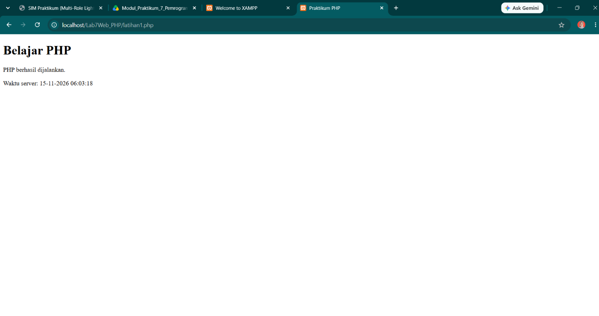
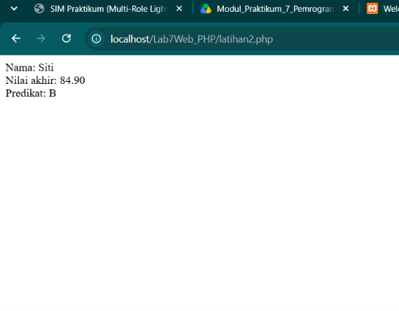
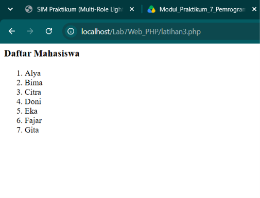
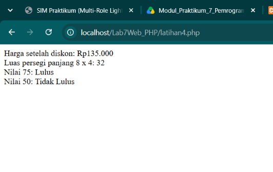
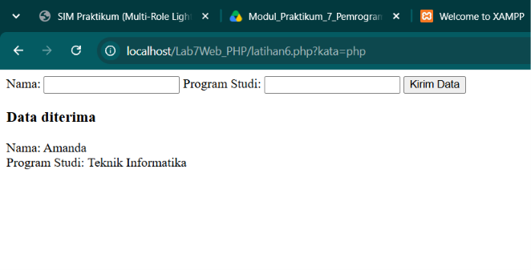
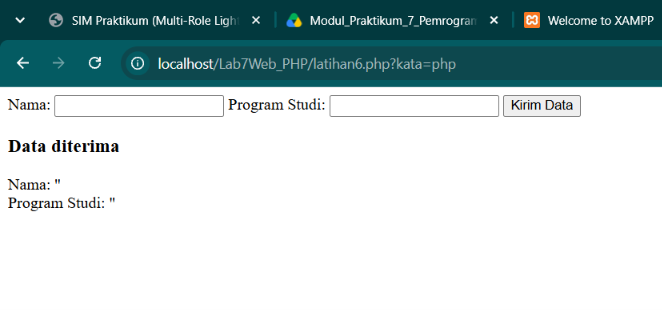
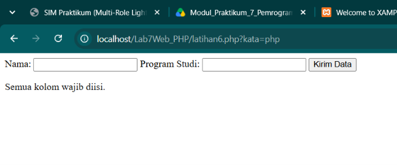
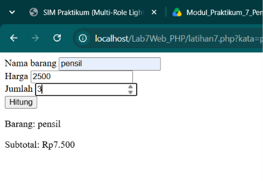
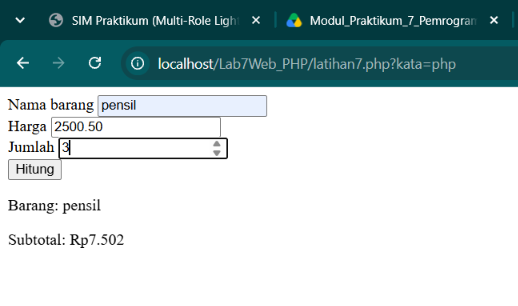
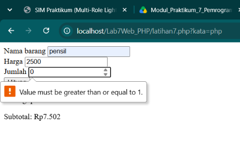
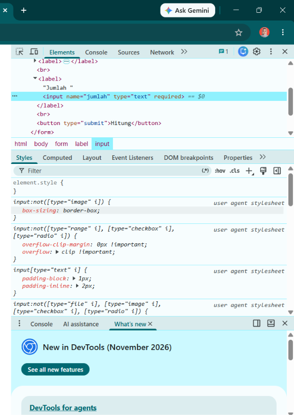
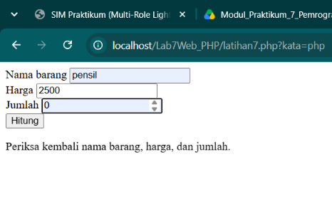
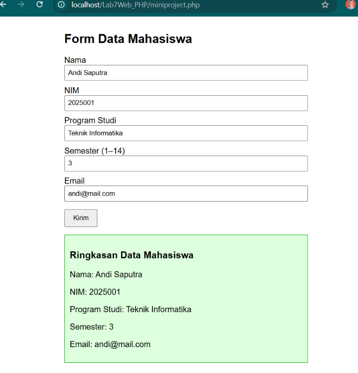
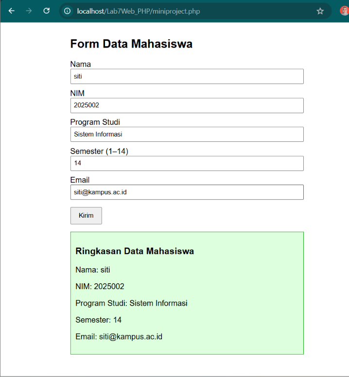
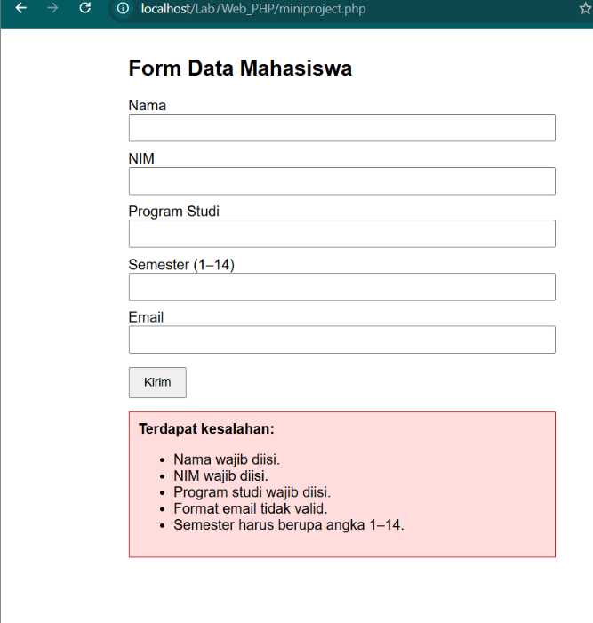
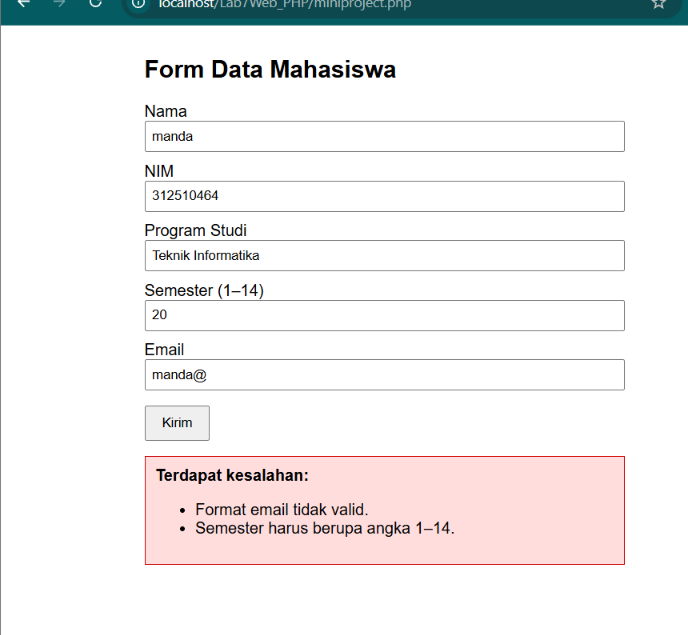
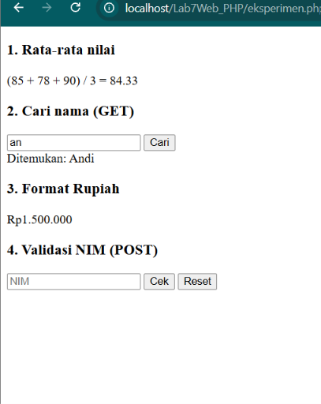
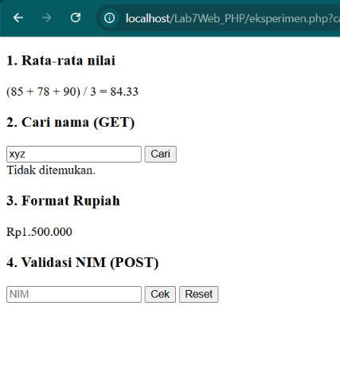
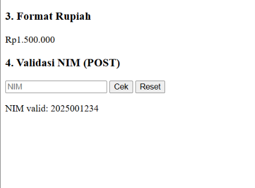